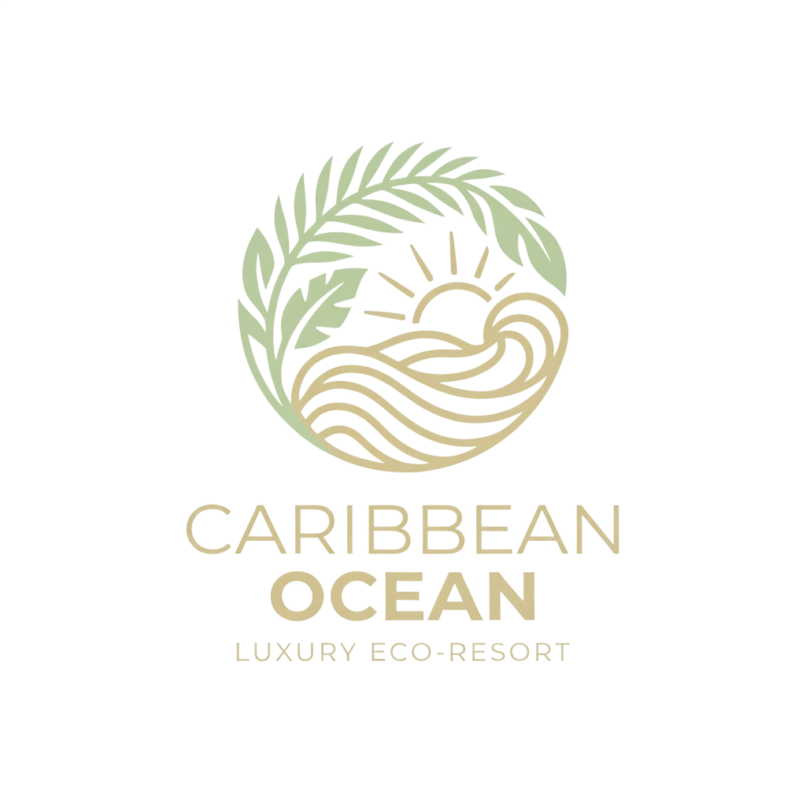
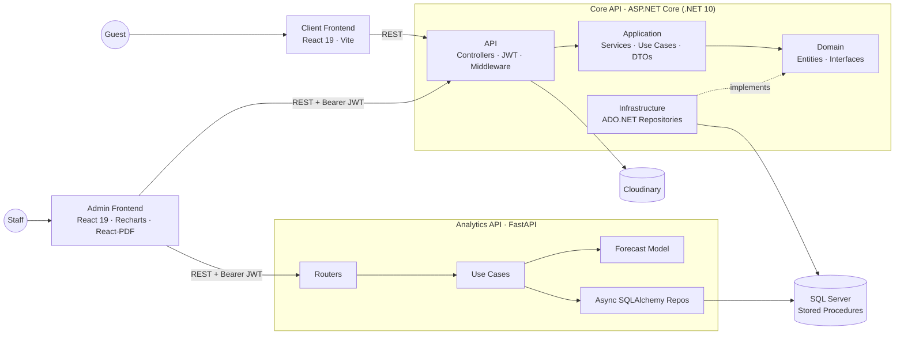

<p align="center">
  
</p>

<h1 align="center">Caribbean Ocean Resort & Spa</h1>

<p align="center">
  <em>Where the jungle meets the sea.</em><br/>
  <strong>Full-stack hotel management platform with online booking, a headless CMS, dynamic pricing & predictive occupancy analytics</strong>
</p>

<p align="center">
  
  
  
  
  
  
  
</p>

---

## 🌴 Overview & Purpose

**Caribbean Ocean** is the digital platform of a fictional luxury eco-resort in Playa Cocles, Puerto Viejo (Limón, Costa Rica). It covers the whole hotel lifecycle in one system: guests explore the resort and book their stay online, while staff manage rooms, reservations, pricing and website content from a protected admin console, backed by an analytics service that forecasts occupancy and tracks revenue.

It was built in 2026 as a **Software Engineering** course project using **SCRUM** (six sprints, rotating Scrum Masters) and Conventional Commits. The goal was a real-world, multi-service architecture rather than a single monolith.

---

## ⚡ What It Does

| Module | Audience | Core Capabilities |
| :--- | :--- | :--- |
| **🏝️ Guest Website** | Visitors | Animated, responsive public site: hero, about us, gallery, facilities, rooms & rates, offers, location, and a multi-step **booking flow** with live availability and price breakdown. |
| **🛎️ Admin Console** | Hotel staff | JWT-protected panel to manage **reservations**, **room types & individual rooms**, **today's room status** (exportable to PDF), **seasons**, **offers**, **ads** and hotel contacts. |
| **📝 Headless CMS** | Content managers | Every public page (hero, about us, gallery, facilities, locations) is edited from the admin panel, with images stored on **Cloudinary**. |
| **💰 Dynamic Pricing Engine** | System | Prices each night separately: `base rate → seasonal adjustment → offer discount`. The per-night breakdown is saved with the reservation for auditing. |
| **📊 Analytics & Forecasting** | Management | Revenue KPIs (by month, room type and offer) and a **seasonal-trend occupancy forecast** with a confidence score, shown as Recharts dashboards. |
| **🕵️ Activity Log** | Admins | Audit trail of admin actions based on action codes, with filters. |

---

## 🏛️ System Architecture

The platform is split into **four independent applications** that share one SQL Server database:



### Architectural Highlights

- **Clean Architecture backend:** four .NET projects (`API → Application → Domain ← Infrastructure`). The Domain layer has no dependencies, and Infrastructure implements its repository interfaces (dependency inversion).
- **One use case per operation:** every business action (`CreateReservation`, `CalculatePrice`, `ValidateOffer`…) is its own class, orchestrated by thin services and registered through DI.
- **Database-first data access:** raw **ADO.NET + stored procedures** handle all reads and writes. A central `SqlExceptionMapper` turns SQL errors into domain exceptions, and a global middleware maps those to HTTP responses.
- **Hexagonal analytics service:** the Python service uses `domain / application / adapters / infrastructure` layers with fully async I/O (`SQLAlchemy async` + `aioodbc`), so the forecast model can be swapped without touching the routers.
- **Feature-sliced frontends:** each feature owns its `components / hooks / services / types`. In the client app, a **Plop** generator scaffolds new features in that structure.
- **Stateless security:** JWT auth with issuer, audience, lifetime and zero clock-skew validation, plus a `Token-Expired` header so the admin app can end expired sessions cleanly.

---

## 🧠 Occupancy Forecast Model

`seasonal_trend_v1` is a lightweight, explainable model that combines three signals for each forecast day:

$$\hat{y}_t = 0.5 \cdot \text{weekday avg} + 0.3 \cdot \text{linear trend}_t + 0.2 \cdot \text{28-day avg}$$

The result is clamped to 0–100%, converted to room counts, and given a **confidence score** that improves with more history and drops with volatility and distance into the future.

---

## 💻 Tech Stack

| Layer | Technologies |
| :--- | :--- |
| **Frontends** | React 19, TypeScript 5.9, Vite 8, React Router 7, Axios, CSS Modules |
| **Admin extras** | Recharts (dashboards), @react-pdf/renderer (printable reports), react-hot-toast |
| **Core API** | ASP.NET Core (.NET 10), JWT Bearer, OpenAPI, Microsoft.Data.SqlClient, CloudinaryDotNet |
| **Analytics API** | Python 3.14, FastAPI, Pydantic v2, SQLAlchemy 2 (async), aioodbc, Uvicorn, uv, Ruff |
| **Data & Media** | Microsoft SQL Server (T-SQL schema, stored procedures, seed data), Cloudinary |
| **Delivery** | Vercel (frontends), Git + Conventional Commits, SCRUM |

---

## 📂 Repository Structure

```text
Caribbean-Ocean/
├── CaribbeanOcean-Backend/          # ASP.NET Core Clean Architecture solution
│   ├── CaribbeanOcean.API/          #   Controllers, middleware, JWT, Cloudinary
│   ├── CaribbeanOcean.Application/  #   Use cases, services, DTOs, mappers
│   ├── CaribbeanOcean.Domain/       #   Entities, interfaces, domain exceptions
│   └── CaribbeanOcean.Infraestructure/  # ADO.NET repositories + SQL scripts
├── CaribeanOcean-Analytics/         # FastAPI revenue & occupancy service
│   └── app/{domain,application,adapters,infrastructure}
├── CaribeanOcean-ClientFrontend/    # Public guest website (React)
└── CaribeanOcean-AdminFrontend/     # Staff admin console (React)
```

---

## 🚀 Quickstart

**Prerequisites:** .NET 10 SDK · Node.js 20+ · Python 3.14 + [uv](https://docs.astral.sh/uv/) · SQL Server · ODBC Driver 18

```bash
git clone https://github.com/DereckGC/Caribbean-Ocean.git
cd Caribbean-Ocean
```

1. **Database:** run the scripts in `CaribbeanOcean.Infraestructure/Base de datos/` in this order: tables → stored procedures → test data.
2. **Core API** (`http://localhost:5287`): set `ConnectionStrings`, `Jwt` and Cloudinary credentials in `appsettings.json`, then:
   ```bash
   cd CaribbeanOcean-Backend/CaribbeanOcean.API && dotnet run
   ```
3. **Analytics API** (`http://localhost:8000`): copy `.env.example` to `.env`, then:
   ```bash
   cd CaribeanOcean-Analytics && uv sync && uv run uvicorn app.infrastructure.main:app --reload
   ```
4. **Frontends:**
   ```bash
   cd CaribeanOcean-ClientFrontend && npm install && npm run dev
   cd CaribeanOcean-AdminFrontend  && npm install && npm run dev
   ```

---

<p align="center">
  Built with 🌊 in Costa Rica · Software Engineering 2026
</p>
=======
# Caribbean-Ocean
Full-stack hotel management platform for a luxury eco-resort in Costa Rica. Built with React 19, ASP.NET Core 10 (Clean Architecture), SQL Server, FastAPI + Python. Features online booking, dinamic content, admin dashboard and an AI-powered reservation prediction model.


# 🌊 Caribbean Ocean Resort & Spa

> Full-stack hotel management platform for a luxury eco-resort in Costa Rica. Features online booking, dynamic CMS, admin dashboard and an AI-powered reservation prediction model.


---

## What it does

The system is split into three independent modules:

- **Public website** — guest-facing React SPA with hero slider, room catalog, 3-step online booking flow, offers carousel, facilities, maps and contact info.
- **Admin portal** — protected management dashboard for reservations (CRUD), room management, dynamic CMS, gallery, hero banners, offers, seasons, advertisement banners, hotel contact info and a revenue dashboard with charts.
- **Analytics service** — async Python REST API that trains a predictive model on reservation data to forecast hotel occupancy.

---

## Tech Stack

| Area | Stack |
|---|---|
| Frontend | React 19 · TypeScript · Vite · React Router v7 · Axios · Recharts |
| Backend | C# · ASP.NET Core 10 · Clean Architecture (Onion) · JWT Auth |
| Database | SQL Server · Stored Procedures |
| Image storage | Cloudinary |
| Analytics | Python · FastAPI · SQLAlchemy (async) · Celery · Redis · scikit-learn |
| Logging | MongoDB |
| DevOps | Docker · Docker Compose · GitHub Actions |

---

## Architecture

The backend follows **Clean Architecture** with strict inward dependency rules:

```
API  →  Application  →  Domain  ←  Infrastructure
```

Domain has zero external dependencies. Interfaces live in Domain, implementations in Infrastructure.

The frontend follows a **Feature-Based (Vertical Slice)** structure — each domain (booking, rooms, dashboard, etc.) owns its components, hooks, services and TypeScript interfaces in isolation.

---
